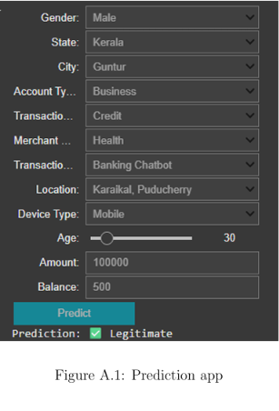

# Bank Fraud Detection Using Machine Learning

## Project Overview

This project is a machine learning case study focused on identifying potentially fraudulent banking transactions using classification algorithms.

The objective is to analyse transaction patterns, explore relevant features and build machine learning models to distinguish fraudulent transactions from legitimate ones.

## Dataset

The project uses a bank transaction dataset (`Bank_Fraud.csv`).

The dataset contains customer, account and transaction-related information.

**Note:** The original dataset is not included in this repository.

## Project Workflow

1. Data loading and exploration
2. Data cleaning and preprocessing
3. Exploratory Data Analysis (EDA)
4. Missing value and duplicate checks
5. Outlier analysis
6. Categorical feature encoding
7. Feature correlation analysis
8. Handling class imbalance using SMOTE
9. Training and comparing machine learning models
10. Model evaluation and feature importance

## Machine Learning Algorithms

The notebook explores the following algorithms:

- Logistic Regression
- Random Forest
- Gradient Boosting
- AdaBoost
- Decision Tree
- Naive Bayes
- XGBoost
- LightGBM
- K-Nearest Neighbors (KNN)
- Multi-Layer Perceptron (MLP)

XGBoost is used for the final model evaluation in the notebook.

## Model Evaluation

The project evaluates model performance using:

- Accuracy
- Precision
- Recall
- F1 Score
- ROC-AUC
- Precision-Recall AUC
- Confusion Matrix

Feature importance is also examined to understand the contribution of different transaction features.

## Technologies Used

- Python
- Google Colab
- Pandas
- NumPy
- Matplotlib
- Seaborn
- Scikit-learn
- XGBoost
- LightGBM
- Imbalanced-learn (SMOTE)

## Project Structure

```text
bank-fraud-detection/
│
├── Bank_Fraud_Detection.ipynb
└── README.md
```

## Prediction Application



## How to View

1. Clone or download this repository.
2. Open `Bank_Fraud_Detection.ipynb` using Jupyter Notebook or Google Colab.
3. The original dataset is required to execute the notebook from the beginning.

## Author

**Hidha C H**

Integrated M.Sc. Computer Science  
Specialisation: Artificial Intelligence & Machine Learning

[GitHub Profile](https://github.com/Hidha09)

## Disclaimer

This project was developed for academic and educational purposes as a machine learning case study. It is not a production-ready banking fraud detection system.
